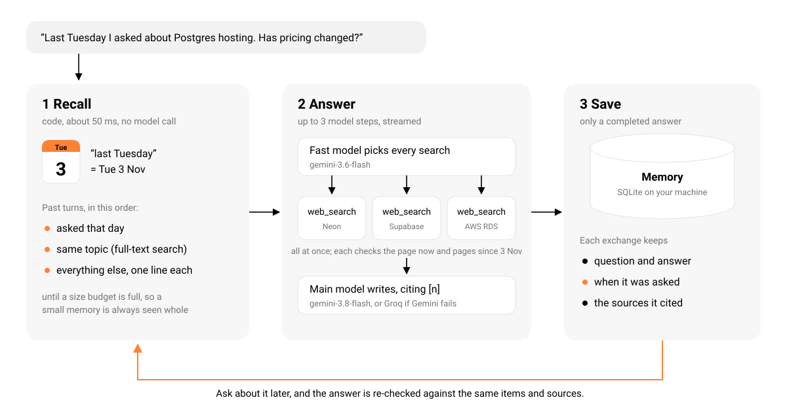

# Design

Every test question has one shape: *find what I asked on a date, then check today's web against
it.* So the design centres on what a model can't do alone: know what happened when, and check an
old answer properly.

## How it works, and why

**Memory is context, not a tool.** The brief allows one tool, and a recall tool would cost a round
trip and depend on the model calling it. Before the model runs, `temporal.ts` turns date phrases
into time windows (chrono-node, plus fixes such as "this Monday" never landing in the future), and
`recall.ts` fills a size budget in order: turns on those dates, topic matches (SQLite FTS5), then
everything else at one line each. An ambiguous weekday gets two candidate days; a wrong day is
caught by topic.

**Every answer is stored with its time and cited sources,** so "is it still correct?" is
mechanical. `web_search({query, since})` runs two requests at once: the current page, unfiltered
because pricing pages are edited in place, and pages published since. For questions about change,
code fills in `since` from the recalled date, because Groq's model often forgot to. Each item is
reported as unchanged, changed, or not verifiable.

**Fewer serial steps.** No planner or summariser call. A fast model (gemini-3.6-flash) picks every
search in one step, they run in parallel, and gemini-3.8-flash streams the answer. If Gemini fails
before any text, Groq answers; a failing provider rests 30 s or as long as its rate limit asks.

## Measured

- **Live** (`npm run eval`, 16 conversations): 16/16 pass. Median time to first words is **6.0 s
  with search**, **1.7 s without**.
- **Offline** (`npm test`, 84 tests, no keys): a scripted network replays both providers' real
  streams and forces rate limits, stalls, broken streams, bad tool calls, search failures and a
  closed tab. They found four bugs, including Hindi split apart by full-text search.
- The eval changed the code: gemini-3.6-flash called prices "unchanged" citing one source for then
  and now, so it only picks searches; Tavily's "news" topic answered "Supabase pricing" with OECD
  tax stories, so it was dropped.

## Considered and rejected

- **Memory as a second tool:** against the brief, and an extra round trip.
- **Embeddings:** every sample is keyed by a date; FTS plus recency covers one user's history
  without another vendor.
- **Vercel AI SDK:** v7 renamed its loop APIs this year. One `fetch` path covers both providers.
- **Gemini's built-in search:** no Groq equivalent, no date filter, no sources to store.
- **better-sqlite3:** a native build `npm install` can fail on. `node:sqlite` ships with Node.

## Scaling and limits

Built for one person on one machine. A turn is one streamed request with no server-side session,
so many users change the stores, not the shape: Postgres keyed by user instead of SQLite,
cool-downs in Redis, server-side keys with per-user caps, searches cached per query per day, and
the per-stage timings exported as metrics. Limits: beyond the budget (hundreds of turns) an
undated paraphrase can be missed, stored sources are excerpts, and two model calls plus a search
is the latency floor.

## With another week

1. **Store structured claims** (item, value, source, date) and compare those, not prose. That
   enables minimi's real job: a background check that pings you when a claim changes.
2. **An LLM-judged correctness eval**, run nightly, gating model and prompt changes.
3. **Hybrid recall** (embeddings plus FTS), only once memory outgrows the budget.
4. **Start each search as its tool call streams in.**
