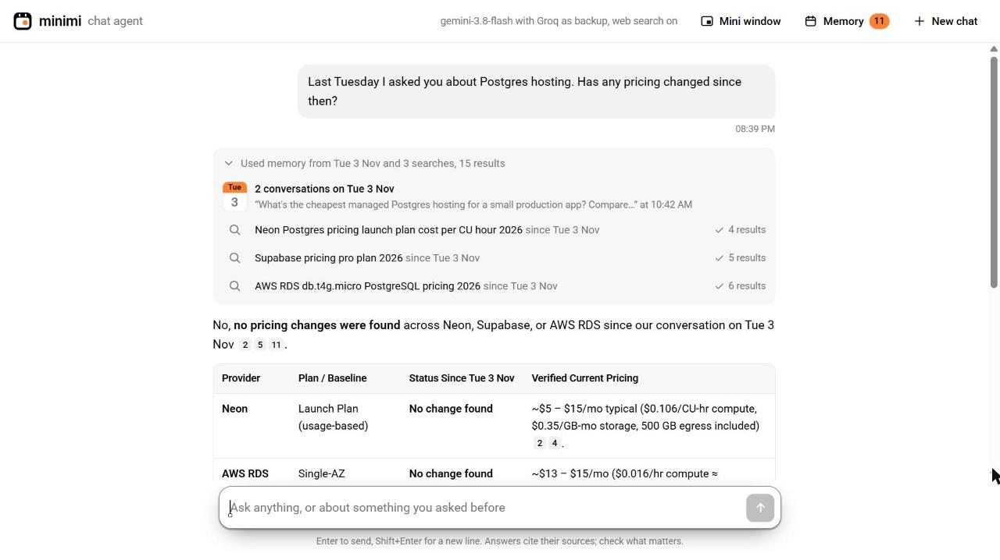
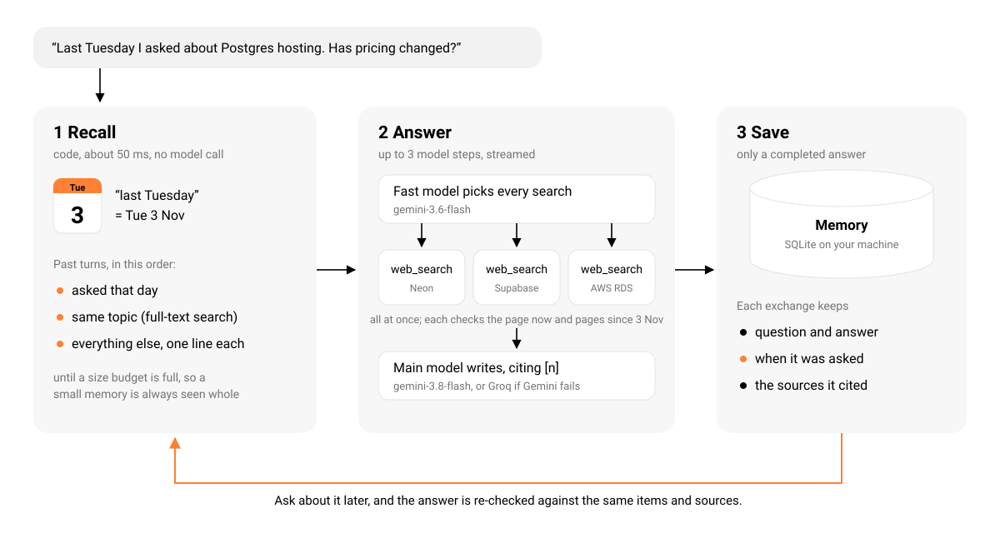

<p align="center">
  
</p>

<h1 align="center">minimi chat agent</h1>

<p align="center">
  <strong>Remembers what you asked, and when.</strong><br>
  A chat agent with one tool, web search, that can tell you whether its old answers still hold.
</p>

<p align="center">
  <a href="#run-it">Run it</a> ·
  <a href="#how-it-works">How it works</a> ·
  <a href="#reliability">Reliability</a> ·
  <a href="DESIGN.md">Design notes</a>
</p>

<p align="center">
  <a href="https://github.com/SanyamWadhwa07/minimi-chat-agent/actions/workflows/test.yml"></a>
  <a href="https://github.com/SanyamWadhwa07/minimi-chat-agent/releases/latest"></a>
  <a href="LICENSE"></a>
  
</p>

<p align="center">
  
</p>

Ask *"Last Tuesday I asked you about Postgres hosting. Has any pricing changed since then?"* It finds
Tuesday's conversation, re-checks each price against today's web in parallel, and answers item by
item, with sources.

## Run it

Needs Node.js 22.13 or newer.

```bash
npm install
cp .env.example .env     # add the keys below
npm run dev              # http://localhost:3000
```

| Key | Free from | |
|---|---|---|
| `GEMINI_API_KEY` | [aistudio.google.com/apikey](https://aistudio.google.com/apikey) | main model |
| `GROQ_API_KEY` | [console.groq.com/keys](https://console.groq.com/keys) | backup when Gemini fails (optional) |
| `TAVILY_API_KEY` | [app.tavily.com](https://app.tavily.com) | web search |

A new install remembers nothing yet. `npm run seed` asks the agent three real questions dated
last Tuesday, Monday and 3 November, so the questions above have something to find.

## How it works



- **Memory is recalled by code, not by a tool.** "Last Tuesday" becomes a date before the model
  runs, so recall costs no model call and cannot be skipped.
- **Answers are saved with their time and sources.** "Is it still correct?" re-checks the same
  items, against the current page and against pages published since that day.
- **Two model steps, not five.** One picks every search, all run at once, one writes the answer.

Why each choice, what was measured and what was rejected: [DESIGN.md](DESIGN.md).

## Reliability

Every row is a test that runs without keys: `npm test`, 83 tests, about 2 seconds.

| When | What happens |
|---|---|
| Gemini fails before writing | Groq answers and the page says so; Gemini rests for 30 s, or as long as its rate limit asks |
| A model stalls | no first word in 20 s, or silence for 15 s mid-answer: stopped with a clear message |
| A search fails or takes over 6 s | the answer says what it could not check |
| You press Stop or close the tab | the model and searches are cancelled; nothing half-done is saved |
| A date is ambiguous or wrong | both readings are tried; a conversation on another day is found by topic |
| A web page says "ignore your instructions" | it is treated as data |
| An answer contains HTML or scripts | sanitised: no scripts, event handlers, styles or non-web links |
| A bad request, a busy port | a short JSON error; the next free port; this machine only |

`npm run eval` replays 16 conversations against the live models and search, including the three
from the brief, a deliberately outdated answer, a question in Hindi and a hostile web page:
**16/16 pass**, with the first words of an answer after a median 6.0 s when it searches and
1.7 s when it does not.

## License

[MIT](LICENSE)
